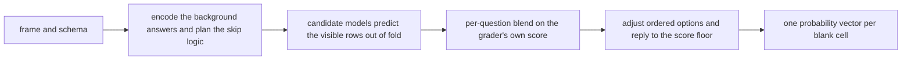

# SimulacraBench entry: Ludilume Studios

[](https://github.com/talhaabidj/simulacrabench-ludilume/actions/workflows/checks.yml)
[](LICENSE)

Code for the Test submission of team Ludilume Studios (Talha Abid, University of
Central Punjab, Pakistan) to [SimulacraBench](https://www.codabench.org/competitions/17822/),
a NeurIPS 2026 competition. The task is to predict, for each held-out survey
answer, a probability for every answer option, on three instruments from UNICEF,
the World Bank and UNHCR.

This repository holds the exact files that were scored, and two scripts that
rebuild the submitted zip byte for byte.

## Contents

- [At a glance](#at-a-glance)
- [Quick start](#quick-start)
- [What is in this repository](#what-is-in-this-repository)
- [How the method works](#how-the-method-works)
- [How the submission runs](#how-the-submission-runs)
- [Rebuild and verify](#rebuild-and-verify)
- [Run it on practice data](#run-it-on-practice-data)
- [Hardware and time](#hardware-and-time)
- [Pretrained models](#pretrained-models)
- [Third-party code in the zip](#third-party-code-in-the-zip)
- [Data](#data)
- [Evidence in short](#evidence-in-short)
- [Limitations](#limitations)
- [Troubleshooting](#troubleshooting)
- [Citation](#citation)
- [Licence](#licence)
- [Acknowledgements](#acknowledgements)

## At a glance

| | |
|---|---|
| Competition | SimulacraBench, NeurIPS 2026 competition track ([simulacrabench.org](https://simulacrabench.org/)) |
| Team | Ludilume Studios (Codabench participant `Talha`) |
| Scored submission | Test phase, Codabench submission 1053745, 15 November 2026 |
| Submitted file | `submission.zip`, 943,721,566 bytes, SHA-256 `ec48ff5629f21732c38bf83147571bf1bb049211c03c3286464f35843b0f9c5b` |
| What this repository reproduces | that file, byte for byte |
| What it cannot reproduce | the score: the survey data are not public |
| Licence of our code | MIT |

Skill is 0 for the crowd marginal and 1 for a perfect prediction.

| | Grand Prize | UNICEF | World Bank | UNHCR |
|---|---|---|---|---|
| Test (1053745) | 0.4862 | 0.3426 | 0.2368 | 0.8793 |
| Development, the same zip (1052251) | 0.4878 | 0.3499 | 0.2486 | 0.8650 |
| Development, our leaderboard entry (1039127, an earlier build) | 0.4943 | 0.3499 | 0.2486 | 0.8843 |

The leaderboard shows these rounded to two decimals. Development readings are
noised and rounded by the platform and are not comparable with Test.

## Quick start

You need Python 3.10 or later, git, about 2 GB of free disk space and an
internet connection. No GPU and no extra packages are needed. If your system
calls Python 3 `python`, use that in place of `python3`.

```bash
git clone https://github.com/talhaabidj/simulacrabench-ludilume
cd simulacrabench-ludilume
git checkout test-submission-1053745
python3 scripts/fetch_weights.py
python3 scripts/build_submission.py
```

The last lines should read:

```
156 files match manifest.json
.../dist/submission.zip
SHA-256   ec48ff5629f21732c38bf83147571bf1bb049211c03c3286464f35843b0f9c5b
submitted ec48ff5629f21732c38bf83147571bf1bb049211c03c3286464f35843b0f9c5b
The zip is byte-identical to the Test submission.
```

The tag `test-submission-1053745` marks the commit that the technical report
cites. The files under `submission/` and `manifest.json` are the ones that were
scored; they have not changed since they were added to this repository.

## What is in this repository

| Path | What it is |
|---|---|
| `submission/main.py` | The submission: defines `predict(frame, schema)`. Unchanged since it was scored |
| `submission/requirements.txt` | Packages the hosted image lacks, pinned to exact versions |
| `submission/libgomp-*.so.1`, `libgomp-copyright.txt` | The OpenMP runtime that LightGBM needs, loaded only when the system has none |
| `submission/sdm/`, `submission/licenses/`, `submission/NOTICE` | Third-party code and licences that were in the zip (see [below](#third-party-code-in-the-zip)) |
| `manifest.json` | SHA-256 and size of every file in the submitted zip, the zip's own hash, and the pinned source of each model file |
| `scripts/fetch_weights.py` | Downloads the three model files at their pinned commits and checks their hashes |
| `scripts/build_submission.py` | Checks every file against the manifest and writes `dist/submission.zip` |
| `scripts/manifest.py` | Helpers the two scripts share |
| `scripts/test_*.py` | Checks of the repository that need no GPU and no model files |
| `requirements-dev.txt` | The pinned tool that runs the checks |
| `.github/workflows/checks.yml` | Runs the checks on Linux, macOS and Windows for every change |
| `CITATION.cff` | How to cite this repository |

The three model files (about 1 GB) are not in the repository. They are fetched
from their authors' pages and checked by hash.

A few comments in `main.py` mention `REVIEW.md`. That is a private development
log and is not part of this repository.

## How the method works

Everything is fitted inside `predict()` on the respondents whose answers are
visible. No model is trained beforehand on survey data.



1. **Candidates per question.** For each scored question, several models
   predict the answer from the respondent's always-visible background answers
   (the schema calls them GIVEN):
   - the crowd marginal, and count tables over the most informative background
     columns, smoothed toward coarser tables;
   - regularised multinomial logistic regression, with and without the most
     informative column pairs;
   - gradient-boosted trees (LightGBM) in several settings, including one with
     target-encoded inputs and one for questions with ordered options;
   - multi-task neural networks that share one trunk across all questions;
   - three tabular foundation models used in context, without fine-tuning:
     TabICL v2, TabPFN v2 and TabPFN-3.5.
2. **Skip logic.** When a question's gate parent is a background answer and the
   visible rows obey the rule, closed rows get the "not asked" option directly.
   When the parent is itself a scored question, extra candidates combine the
   parent's predicted answer with a model fitted on the rows that were asked.
3. **Household matching (UNHCR).** The UNHCR file holds two survey rounds.
   UNHCR's public note on the survey's second wave says that it recontacted the
   first-wave households (see [Data](#data)). The competition schema neither
   says that its rounds are those waves nor gives an identifier that links a
   household across them. In case households do appear in both rounds, rows
   from the two rounds are matched when each is the other's best match by a
   clear margin, first on their answers and then, at a lower bar, where the
   background columns also agree. A matched partner's answers give two more
   candidates per question. The step stays off when it finds fewer than 30
   matches, and the hosted run does not tell us whether it switched on. We
   asked the organizers whether a model may benefit from such matches, using
   only the GIVEN columns and the visible rows provided at run time; they
   replied by email (6 November 2026) that this is permitted. Nothing is
   matched to any outside source, and no person is identified.
4. **Blend.** Every candidate predicts the visible rows out of fold. Per
   question, mixture weights are fitted by EM to maximise the grader's own
   floored log score on those predictions, and the better of a linear, a
   tempered or a log pool is kept. The held-out rows get that blend.
5. **After the blend.** For ordered options, some probability may move to the
   neighbouring options when that scores better out of fold. The grader mixes
   every vector with a small flat floor before scoring; the vector sent is the
   one whose scored version equals the blend, whenever that scores better out
   of fold.

Every setting is a constant near the top of `submission/main.py`. The technical
report submitted to the competition's OpenReview venue lists them all and
describes the method and its evidence in full.

## How the submission runs

The grader imports `main.py` and calls `predict(frame, schema)` once per
instrument. `frame` holds every respondent, with the held-out answers blank.
`predict()` returns one probability vector per blank cell.

- **One clock for three instruments.** The time limit covers all three calls
  together. Each call takes a share of what is left, by a nominal need that
  grows with its number of scored questions.
- **Passes, cheapest first.** Work runs in passes, so a slow machine loses
  accuracy, not answers. Any candidate that fails is dropped. A question with
  nothing left gets the crowd marginal.
- **No silent weak run.** On a real instrument the run stops with an error if
  TabICL or TabPFN-3.5 cannot load, because a failed Test run may be repeated
  and a weak finished one may not.
- **No network, no files.** The model files are read from the zip. Nothing is
  downloaded or written during a run.

The hosted platform sets none of the switches below. They exist for testing.

| Environment variable | Effect | Default |
|---|---|---|
| `SB_BUDGET_SCALE` | Multiplies the time budget | `1` |
| `SB_JOBS` | Number of worker threads | the smaller of 8 and the CPU count |
| `SB_ICL_CPU` | When set, TabICL runs on the CPU | not set (GPU) |
| `SB_REQUIRE_MODELS` | `0` lets a run continue without TabICL or TabPFN-3.5 | `1` |
| `SB_DEBUG` | Path of a file that receives the time of each pass | not set (nothing is written) |

## Rebuild and verify

`fetch_weights.py` downloads three files, about 1 GB together, from Hugging
Face. No account is needed. Each file is kept only if its size and SHA-256
match `manifest.json`. If the connection drops, the script continues from where
it stopped; if it gives up, run it again. `build_submission.py` then checks all
156 files and writes `dist/submission.zip`. The download takes from a few
minutes to half an hour, depending on the connection; the build takes under a
minute.

The zip is written with fixed names, order, dates and permissions. With zlib
1.2.12 it is byte-identical to the submitted file. With another zlib version
the compressed bytes can differ; the script then says so, and the 156 files
inside are still identical, each checked by hash. To see your zlib version:

```bash
python3 -c "import zlib; print(zlib.ZLIB_RUNTIME_VERSION)"
```

To check the zip against the competition's contract, use the official starter
kit (<https://github.com/SituatedEvals/public>, commit `aa03186` or later):

```bash
python3 tools/check_submission_zip.py /path/to/dist/submission.zip
```

To run this repository's own checks:

```bash
python3 -m pip install -r requirements-dev.txt
python3 -m pytest scripts
```

They cover: every committed file against the manifest; nothing unlisted in
`submission/`; exact version pins; the `predict(frame, schema)` signature; model
addresses at full commit hashes; a zip that is written the same way every time;
and a download that continues after a dropped connection. The same checks run
on Linux, macOS and Windows for every change to this repository.

## Run it on practice data

The real survey data are not public. The starter kit can write practice data of
the same shape and run a submission the way the grader does. Its answers are
invented, so the score it prints says nothing about the real one; it shows that
the code runs within the contract.

After the quick start above, with the model files in `submission/`:

```bash
git clone https://github.com/SituatedEvals/public starter-kit
cd starter-kit
python3 -m pip install -r requirements.txt
python3 make_sandbox.py --schema data/unicef.json --out _sandbox/unicef
python3 score.py --submission /path/to/simulacrabench-ludilume/submission \
                 --data _sandbox/unicef --schema data/unicef.json --phase 1
```

`score.py` installs `submission/requirements.txt` into a fresh environment and
runs `predict()` with the network removed. Use `--phase 2` for the Test
setting. We ran it this way on Kaggle and Colab GPUs; we did not test a run
without a GPU.

## Hardware and time

The hosted grader ran the zip on Python 3.13 with one H100 GPU, 8 CPUs and
16 GB of memory, under a limit of 3,600 seconds for the three instruments
together. The hosted image already holds PyTorch, scikit-learn and SciPy; the
other packages are pinned in `submission/requirements.txt`. Our Test run took
about 36 minutes.

Our own full-length rehearsals ran on a 16 GB T4 GPU and used nearly the whole
3,600 seconds.
